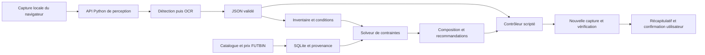

# Architecture

## Composants

| Composant | Responsable principal | Entrée / sortie |
| --- | --- | --- |
| Perception | Saber | Image vers éléments et boîtes |
| OCR et normalisation | Rayan | Régions vers textes et attributs sourcés |
| Inventaire | Rayan | Cartes identifiées vers exemplaires, versions et quantités |
| Marché | Rayan | Sources FUTBIN vers catalogue et relevés datés |
| Solveur | Rayan | Club, règles, protections et candidats vers solution vérifiée |
| Contrôleur | Samy | État structuré vers clic/saisie, puis observation |
| API et application | Samy | Transport des images/résultats, erreurs et affichage |

## Socle présent

- `/health` indique que le processus HTTP répond, pas qu'un modèle est chargé.
- `/api/v1/capabilities` décrit les briques disponibles.
- `/api/v1/contracts/perception` expose le schéma de sortie attendu.
- Les modèles Pydantic et les fixtures permettent de développer les briques séparément.

L'inférence, la persistance et les actions ne sont pas encore câblées. Ne pas brancher des prédictions synthétiques sur un compte réel.

## Contrat de perception v0.1

Les coordonnées sont des pixels dans la capture d'origine, origine en haut à gauche. La réponse indique la taille de l'image, le modèle et les éléments : identifiant, type, boîte, texte, confiance, actions possibles. Toute boîte doit rester dans l'image ; les identifiants sont uniques.

Le JSON sémantiquement valide ne garantit pas une bonne prédiction. La qualité est évaluée séparément avec les annotations.

## Déploiement cible

Le client React et le contrôleur local consomment une API Python hébergeant les modèles. Le frontend n'embarque pas leurs poids. Les données SQLite appartiennent au service applicatif ; les originaux privés restent locaux par défaut. Le cloud devra prévoir des limites de taille, délais, authentification et suppression des captures temporaires avant un déploiement partagé.
