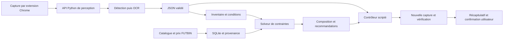

# Architecture

## Composants

| Composant | Responsable principal | Entrée / sortie |
| --- | --- | --- |
| Perception | Saber | Image vers éléments et boîtes |
| OCR et normalisation | Rayan | Régions vers textes et attributs sourcés |
| Inventaire | Rayan | Cartes identifiées vers exemplaires, versions et quantités |
| Marché | Rayan | Sources FUTBIN vers catalogue et relevés datés |
| Solveur | Rayan | Club, règles, protections et candidats vers solution vérifiée |
| Contrôleur | Samy | État structuré vers clic/saisie, puis observation |
| API et application | Samy | Transport des images/résultats, erreurs et affichage |

## Socle présent

- `/health` indique que le processus HTTP répond, pas qu'un modèle est chargé.
- `/api/v1/capabilities` décrit les briques disponibles.
- `/api/v1/contracts/perception` expose le schéma de sortie attendu.
- Les modèles Pydantic et les fixtures permettent de développer les briques séparément.
- L'importeur en ligne de commande alimente un catalogue et des relevés de prix SQLite.
- Un rapport OCR peut déclencher une recherche ciblée des versions manquantes par nom ; les statistiques visibles affinent les candidats, sans créer d'exemplaires ni choisir une version automatiquement.
- L'inventaire local référence les versions du catalogue et conserve chaque exemplaire, sa protection, son état échangeable connu ou inconnu et sa dernière observation. Une démo distincte utilise un club fictif.
- Un lot de lectures OCR et de versions choisies peut être confirmé dans cet inventaire ; l'écriture est atomique et conserve les exemplaires déjà connus.
- `sync_scan` réunit plusieurs rapports et leurs choix : aperçu sans écriture, fusion par exemplaire suivi, protections conservées et lectures non sélectionnées en attente. Le suivi et la fin du parcours restent fournis par le contrôleur.
- Le solveur lit SQLite, cherche une composition avec CP-SAT et vérifie séparément les affectations, sur un pool connu de cartes et prix.
- La proposition et ses alternatives incluent les valeurs recalculées de chaque condition dans `verification`, avec les limites demandées ; elles restent à confronter à l'état réel de la Web App.
- La commande `demo` relie ces fonctions sur une image fictive annotée et un catalogue synthétique ; les exemplaires passent par la lecture OCR et les conditions sont interprétées depuis les textes lus.

L'inventaire, les protections persistantes et le solveur sont accessibles via HTTP quand
le serveur est explicitement configuré ; voir le [guide API SBC](SBC_API.md).
Le popup de l'extension ajoute la capture manuelle et la conservation de son repère
image/viewport, décrites dans le [guide de capture](TAB_CAPTURE.md).
Un [laboratoire du contrôleur](LOCAL_CONTROLLER.md) teste les clics et la vérification
après action avec une vision déterministe par couleurs et des cartes fictives.
L'inférence réelle, le scan du club et le contrôleur sur les données de l'API restent
à raccorder. Les capacités `controller` et `live_actions_enabled` restent donc fausses.

Les conditions sont transmises dynamiquement par l'OCR au contrat `dynamic-v1`. Le solveur distingue composition et Item Score, traite les contraintes reconnues et vérifie ses résultats séparément. La note d'équipe est limitée à onze emplacements et le collectif à un profil standard sans bonus particuliers. Les autres cas sont rejetés. Le [guide](../src/sbc_vision/sbc_engine/README.md) précise les limites et l'interface entre les membres.

Les contrats `CardReading` et `ClubItem` préparent le raccordement à l'OCR et au contrôleur. Une version candidate reste à confirmer et l'identité des exemplaires entre captures est à gérer côté contrôleur. Les quantités et protections ne sont jamais déduites du seul nom du joueur.

## Contrat de perception v0.1

Les coordonnées sont des pixels dans la capture d'origine, origine en haut à gauche. La réponse indique la taille de l'image, le modèle et les éléments : identifiant, type, boîte, texte, confiance, actions possibles. Toute boîte doit rester dans l'image ; les identifiants sont uniques.

Le JSON sémantiquement valide ne garantit pas une bonne prédiction. La qualité est évaluée séparément avec les annotations.

## Déploiement cible

L'extension Chrome héberge l'interface React et le contrôleur du navigateur ; elle consomme une API Python hébergeant les modèles. La reconnaissance des éléments et des cartes repose sur les captures et l'OCR. Les modèles et le solveur restent côté Python. Un premier prototype devra vérifier la capture, les coordonnées et les permissions nécessaires aux interactions.

Les données SQLite appartiennent au service applicatif ; les originaux privés restent locaux par défaut. Le cloud devra prévoir des limites de taille, délais, authentification et suppression des captures temporaires avant un déploiement partagé.
